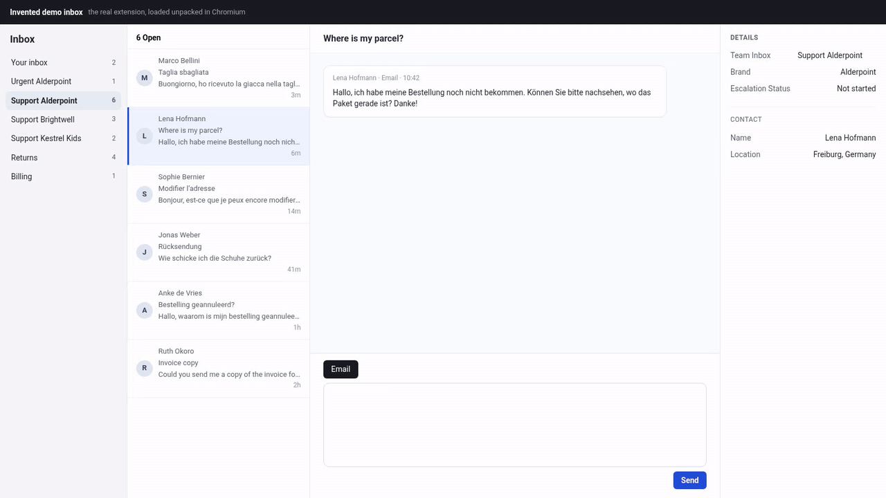
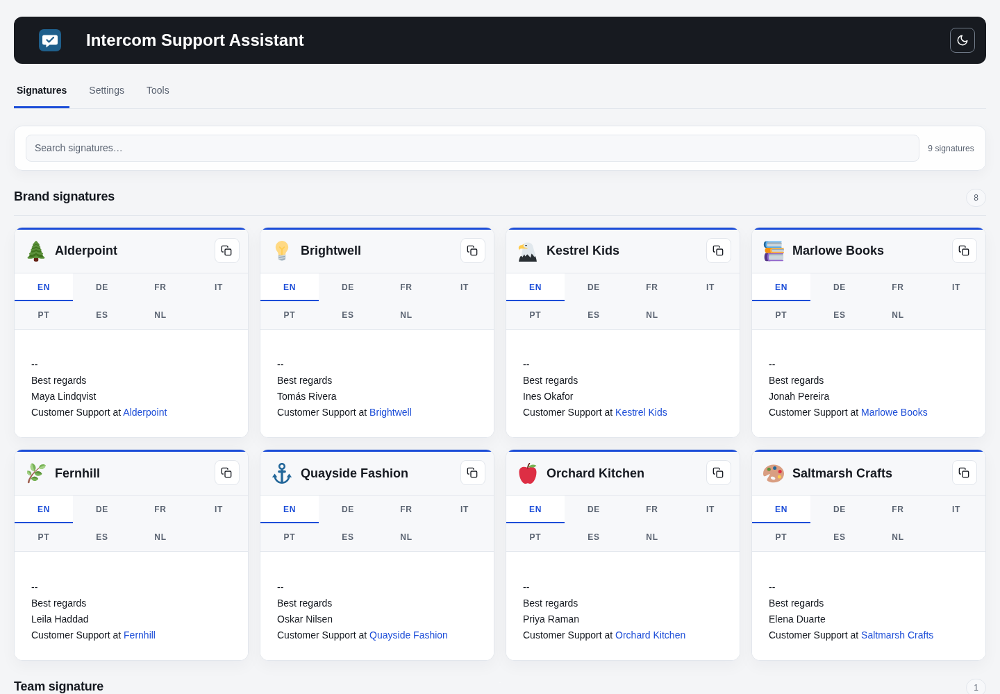
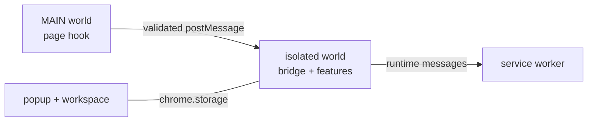

# Intercom Support Assistant

[](https://github.com/bartech-lab/intercom-support-assistant/actions/workflows/ci.yml)

A Chrome extension that makes the Intercom inbox safer for a support team
answering for the storefronts of one retail group in seven languages.
Current version: **v1.0.0.0**.



The extension began as a side project for a multi-brand support team and is in
daily use there. This is its open-source edition: every brand, person, address
and id in it is invented.

## How it is tested

About 2,280 automated tests in 161 files run in about 15 seconds with
`node --test` and jsdom. They are unit and integration tests; there is no
end-to-end suite against a live Intercom workspace, because the extension does
not own one.

- **The real code, in the real order.** The harness loads the shipped `src/`
  files into a jsdom window in the order `src/manifest.json` declares, so a
  load-order mistake fails the suite.
- **Failure modes first.** Tests target the case a plausible wrong
  implementation gets wrong: stream parts out of order, a sidebar still showing
  the previous conversation, a cache filled one past its cap, a payload at the
  size limit and one byte over it.
- **A new test must fail once.** Before a new test is kept, it is run against a
  one-line bug in the rule it covers, and it has to fail there.
- **One real browser test.** An opt-in test loads the unpacked extension in
  Chromium and checks that hovering decorated rows never rebuilds a decoration.
  The demo above is recorded the same way, by `tools/record-demo.js`.
- **Repository rules are tests too:** no code comments, every file mapped in
  the domain map, no host outside the allowlist in the build, and the leak
  scanner checked against planted values.

Details: [docs/testing.md](docs/testing.md).

## What it does

| Feature | The failure it prevents |
| --- | --- |
| **Localized signatures.** An empty email reply gets the right brand's signature in the customer's language; a chip row lets the agent switch language. | A reply signed for the wrong brand or in the wrong language. |
| **Close safeguards.** Close is blocked while `Escalation Status` is `In Progress`, or while the last part is an internal note linking to Slack, Jira, or Linear. | Closing a conversation whose work moved to another team and is not finished. |
| **New-message alerts.** A chime, a desktop notification, and a blinking tab for chosen inboxes. | An urgent conversation waiting unseen in a background tab. |
| **Self-deleting notes.** User notes can carry an expiry, from 1 hour to 90 days or a chosen date, and are deleted after it. | Internal notes that outlive their purpose, often holding a delivery address or phone number. |
| **Duplicate conversations.** Open conversations from one customer are colour-grouped, with links between them. | Three agents answering the same question three times. |
| **Team-inbox autoselect, support-origin marks, attachments list, DOM capture.** | Smaller daily slips, and selector bugs that cannot be reproduced. |



## Architecture



- **No build step.** `src/` is exactly what ships. 25 classic content scripts
  share one isolated world in the order `src/manifest.json` declares, and the
  build verifier checks that order.
- **A passive page hook.** A MAIN-world script reads responses Intercom already
  requests and relays one bounded, validated value per kind. It sends no request
  of its own.
- **Network data over the DOM.** Intercom's sidebar hides attributes behind
  **See all**, so a set value can look unset. The extension reads the same
  payload the sidebar renders from, and the DOM is the fallback.
- **Fail closed.** When the brand signals disagree, no signature is inserted. An
  unreadable badge is not zero. A malformed note marker is never deleted.
- **Idempotent observer passes.** Every decoration is written only when its
  value changes, because each write is a mutation that would retrigger the
  observer.

Details: [docs/architecture.md](docs/architecture.md).

## Living with a third-party UI

Intercom ships changes without notice. In one week of August 2026 it rebuilt
two views in React, one of them inside a shadow root, and every selector for
each view went to zero at once.

- Selectors anchor on `data-testid` and `data-intercom-target`, never on
  utility classes.
- An **anchor health report** groups selectors per feature and reports `ok`,
  `degraded` (only a broad fallback still matches), `absent`, or `missing`.
- A **DOM capture** button serializes the live page, shadow roots included,
  with the health report embedded. A capture is distilled into an invented
  fixture and then deleted. See [docs/dom-capture.md](docs/dom-capture.md).

## Release process

Four-part versions. `tools/bump-version.js` plans and applies a bump.
`npm run verify` runs six gates (tests, syntax, whitespace, release consistency,
build with artifact verification, ZIP check) and leaves the ZIP that a release
attaches; it is the same folder as `src/`, packed. `tools/release-plan.js`
checks that the release is publishable and prints the commands. Nothing tags or
publishes on its own. See [RELEASE.md](RELEASE.md).

## No real data, enforced

Every fixture is invented: brands on `*.example`, ids in the `900…` range,
addresses on `example.com`. `scripts/leak-scan.mjs` keeps it that way. It scans
every file, file name, and PNG and GIF text block, and with `--history` every
commit, for emails, foreign hosts, long numeric and hex ids, Intercom ids in
URLs, workspace ids and secrets, plus a term list that CI receives as a secret.
A missing term list is exit code 2, not a pass. CI runs
[gitleaks](https://github.com/gitleaks/gitleaks) as a second engine.

## Install

There is no Chrome Web Store listing; the extension is loaded unpacked.

1. Get the extension folder: unzip `Intercom-Support-Assistant-v<version>.zip`
   from a release, or use `src/` from a clone of this repository.
2. Open `chrome://extensions`, turn on **Developer mode**, click **Load
   unpacked**, and pick that folder.
3. Open `app.intercom.com`.

Brands and signatures live in `src/intercom-config.js`. After changing them,
run `node tools/update-preview.js` to regenerate the workspace preview data.

## Develop

```bash
npm ci
npm test          # the fast suite
npm run verify    # the full release gate; also builds the ZIP
```

## License

[MIT](LICENSE)

Not affiliated with or endorsed by Intercom. "Intercom" is a trademark of its
owner and is used here only to name the product this extension works with.
