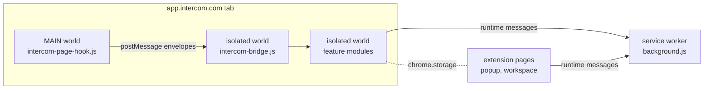

# Architecture

Intercom Support Assistant is a Manifest V3 Chrome extension. It runs inside the
Intercom inbox, a single-page application the extension does not control and
that changes its markup without notice. Most of the design follows from that
fact.

## Execution worlds

| World | Files | Can | Cannot |
| --- | --- | --- | --- |
| MAIN, `document_start` | `src/intercom-page-hook.js` | See the page's `fetch` responses and WebSocket frames | Use any `chrome.*` API |
| Isolated content scripts | the rest of the `content_scripts` list in `src/manifest.json`, in order | Read the DOM, add owned UI, use `chrome.storage` and runtime messages | See page JavaScript globals |
| Service worker | `src/background.js` | Notifications, tab focus, script injection, the note-cleanup lease | Touch any page |
| Extension pages | `src/popup.html`, `src/preview-page.html` | Settings, signature previews, support tools | Run in Intercom |

The content scripts are classic scripts that share one isolated `window`. A
later file uses the top-level declarations of an earlier one, so the order in
`src/manifest.json` is part of the program. `tools/artifact-verifier.js` checks
that order on every build.

There is no build step. `src/` is exactly what ships, which removes a whole
class of "works in source, broken in the bundle" defects and lets a reviewer
read the shipped code directly.

## The page hook is passive

`src/intercom-page-hook.js` wraps `window.fetch` and observes responses
Intercom already requests. It issues no request of its own, and it never
blocks, reorders, or delays page traffic. The one exception is the note
request described under [self-deleting notes](#self-deleting-notes), where it
appends a footer to a body the teammate is already sending.

From each observed response it relays one bounded value per kind: a
conversation id plus a language token, a numeric team id, a brand name, the
workspace addresses a customer wrote to, or the contact identity used for
duplicate grouping. No message body, header, or unrelated attribute crosses
the boundary.

Page JavaScript can forge a `postMessage`, so the marker on an envelope proves
nothing. `src/intercom-bridge.js` re-validates the source window, origin,
marker, version, kind, id shape, and value shape before storing anything, and
every cache it keeps is bounded and evicts the oldest entry.

The hook buffers envelopes until the isolated side announces itself, then
replays only the latest record per conversation and source.

Network data beats the DOM because Intercom's sidebar renders a fixed slice of
the conversation attributes and hides the rest behind **See all**. A brand that
is set but not rendered looks exactly like a brand that is unset, unless the
value comes from the payload the sidebar renders from.

## Signature routing

Signatures are per brand and per language. `src/intercom-config.js` holds the
brands, their signature text in seven languages, aliases, team-to-brand
mappings, and the inboxes that use the shared team signature.

`detectInboxType` in `src/intercom-context.js` resolves one of three answers:

| Answer | When | Signature |
| --- | --- | --- |
| `excluded` | the Team Inbox is in `excludedInboxes` | none |
| `team` | the Team Inbox is in `teamSignatureInboxes` | the shared team signature |
| `company` | a brand resolves from the signals below | that brand's signature |

The brand signals, strongest first: the conversation's team assignment from
the network, the inbound workspace mailbox, the `Brand` attribute (network
value first, then the sidebar row), the inbox name, and the team id in the URL.

**Disagreement fails closed.** When the signals name different brands, no
signature is inserted, unless the team assignment names the brand that won.
The team is the freshest signal: the URL updates first on navigation while the
sidebar still shows the previous conversation, so two stale sidebar signals can
agree with each other and both be wrong. Inserting nothing is recoverable;
inserting another brand's signature in front of a customer is not.

A warning about that conflict is suppressed only while the sidebar provably
lags: its rendered `ID` row differs from the conversation in the URL.
Resolution and the fail-closed guard are unchanged by that suppression.

In the new-conversation composer there is no conversation yet. The brand comes
from the From address, unless the teammate has hand-picked a Team Inbox. A Team
Inbox counts as hand-picked only after the value the extension itself selected
for the current sender has been seen in the DOM, so a lagging value never
outranks the sender.

### Language

`detectCustomerLanguage` tries, in order: the network `Language` attribute, the
newest `Language` change event in the conversation stream, the sidebar row,
analysis of the customer's own messages, the contact's location, then English.
An attribute must be corroborated by the message text: without a supporting
word or diacritic it loses to the contact's location, and against clearly
different text it yields English. A device footer such as `Inviato da iPhone`
counts as evidence for its language.

A draft has none of those sources. It uses the teammate's pick, then the
contact's language override, a non-English browser locale, the contact's
country, then English.

A row of language chips sits on both composers. The outlined chip and the
inserted signature come from one function, so they cannot disagree. Picking a
language rewrites the signature only while the teammate has not typed over it.

## Close safeguards

`src/intercom-guards.js` intercepts a click on Close, in the capture phase, and
blocks it with an explanation when:

- the `Escalation Status` attribute is `In Progress`, or
- the last part of the conversation is an internal note that links to Slack,
  Jira, or Linear, which usually means the work moved elsewhere and the
  customer is still waiting.

Snooze stays available. The rules are constants in `src/intercom-util.js`
(`IN_PROGRESS_BLOCK_MESSAGE`, `TRACKER_LINK_PATTERN`).

## New-message alerts

Inboxes whose name matches `alertInboxPattern` are discovered from the left
navigation and offered in **Settings**. Detection reads the navigation counts
Intercom already renders. There is no polling and no extra request.

A count must hold the same value for a settle window before it can fire. The
navigation re-renders constantly, and a count that dips and returns during one
re-render looked exactly like an arrival before this rule. Only a settled
increase over the stored per-inbox baseline raises the chime and the desktop
notification. A reload of an inbox with an unread conversation stays quiet.

Reading fails closed. A badge that is missing, or an inbox pinned twice whose
two badges disagree, is unreadable rather than zero.

The notification id carries the tab and window, so a click still focuses the
right tab after the service worker has restarted and lost its memory.

## Self-deleting notes

The **User notes** composer gains an **Auto-delete** checkbox with presets from
1 hour to 90 days, a custom delay, or a custom date and 24-hour time.

1. The composer arms the page hook with the workspace, contact, draft text and
   a lifetime.
2. When Intercom sends exactly that note, the hook appends a footer to the
   body: a readable deadline plus a versioned marker. Body and footer save in
   one request, so a failed second request can never leave a permanent note.
3. On later visits, `src/intercom-note-cleanup.js` deletes expired notes for
   the open contact, one at a time, through the same internal route the Inbox
   uses.

The marker is the only thing that makes a note deletable. Duplicate markers, an
unknown version, a marker that is not last, a readable line that disagrees with
the marker, and a marker for another workspace or contact all fail closed.

Cleanup re-reads the contact and the note immediately before deleting, waits at
least one second between deletions, and reports success only after a fresh
read confirms the note is gone. Tabs coordinate through a 60-second lease held
by the service worker, keyed by workspace, contact and note. A 401 or 403 stops
cleanup until reload; a 429 starts a cooldown from `Retry-After`.

The `HH:MM` field is a text input. Chrome renders native time inputs in the
browser locale, and an `en-US` browser shows an AM/PM spinner that no attribute
can override.

The dropdowns are ARIA select-only comboboxes on a fixed-position layer. A
native `<select>` opened detached from its field, because the sidebar positions
sections with CSS transforms that the native popup ignores.

## Duplicate conversations

A customer who sends the same request several times creates several open
conversations in one inbox. The extension never merges or closes them; it marks
every row in a group with a colour, a `⧉N` chip, and, on the open conversation,
a strip that links to every member.

The key is the contact's email from the conversation-list payload, then the
contact id, then the display name when no payload was observed. A customer who
shops at several storefronts can have one contact record per storefront mailbox,
so only the email keeps one person in one group.

Rows have a fixed height that Intercom sets before the extension decorates
them, and rows are packed with zero slack. Every chip therefore sits in a
horizontal tray on the title line and adds no height.

Only an **Open** list is marked; a Closed folder holds years of history.

## Other features

| Feature | Module | Summary |
| --- | --- | --- |
| Support-origin mark | `src/intercom-row-decorations.js` | Marks a row whose first customer email went to a support address listed in `supportInboundLocalParts`. |
| Team-inbox autoselect | `src/intercom-autoselect.js` | In a new email, picking a From address selects its Team Inbox, at most twice per sender. |
| Attachments | `src/intercom-attachments.js` | A header button lists every file in the loaded messages, customer and teammate uploads apart. |
| Multi-recipient warning | `src/intercom-row-decorations.js` | Outlines an email's header when it was sent to two or more addresses. |
| DOM capture | `src/dom-capture.js` | Serialises the page, shadow roots included, for offline debugging. See [dom-capture.md](dom-capture.md). |

## Observer passes

One `MutationObserver` drives every decoration. Mutations the extension caused
itself are filtered out, and a leading-edge pass is followed by a trailing pass
so a burst of mutations still ends in a full pass. Each pass is idempotent: a
decoration is written only when its value changes, because every write is
itself a mutation and an unconditional write loops forever.

A per-pass cache shares expensive reads, such as the sidebar attribute rows,
between features within one pass and is dropped at the end of it.

## Resilience against a third-party UI

- **Selectors** anchor on `data-testid`, `data-intercom-target`, and similar
  attributes, never on styled utility classes, which change on every Intercom
  deploy.
- **Anchor health.** `buildAnchorHealthReport()` in `src/intercom-dom.js`
  groups the selectors per feature and reports `ok`, `missing`, `degraded`, or
  `absent`. It is embedded in every DOM capture, so a capture says on its own
  whether a selector has drifted.
- **Shadow DOM.** Parts of the Inbox render inside the `#teammate-app-react`
  shadow root. Queries search it first, then the document.
- **Two installs.** A decoration records the extension id that drew it. Another
  install never removes it, so two builds on one page cannot fight over a row.

## Storage

| Key prefix | Area | Owner |
| --- | --- | --- |
| `isaAlert*` | `chrome.storage.local` | alert settings and baselines |
| `isaDebug`, `isaAlertDebug` | `chrome.storage.local` | debug logging flags |
| `isaPauseAutomaticNoteCleanup` | `chrome.storage.local` | per-browser cleanup pause |
| note-cleanup leases | `chrome.storage.session` | `src/background.js` |
| `isaTheme` | `localStorage` of the extension pages | `src/theme.js` |
